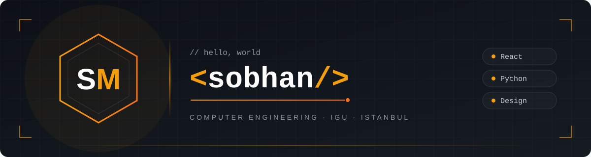

<div align="center">

# ☕ IGU Café

### Skip the line. Order from your phone. Grab your coffee.


</div>

---

## 💡 Why I built this

Between classes at Istanbul Gelişim University, the café line gets *long*. Everyone wants coffee at the same time, and half the break disappears waiting.

So I decided to build a fix: students order from their phones, the café gets orders instantly, and nobody has to stand in line. My goal is to see it running in our real café, and if not, it's still the most complete project I've built so far. 🚀

---

## ✨ Features

### 🎓 For students
- 🔐 Sign in with a one-time email code, no passwords to remember
- 📋 Browse the menu and build a cart
- 📝 Add a note to your order
- 📡 Watch your order status live: **received → being prepared → ready**
- 📳 Your phone vibrates when your order is ready

### 👨‍🍳 For staff
- ⚡ Live dashboard, new orders appear instantly
- 🔄 One tap to move orders: preparing → ready → picked up
- 💵 Mark orders as paid at the counter
- 🧾 Print 80mm thermal receipts in Turkish
- 🚫 Mark items sold out in one tap

### 📊 For the café manager
- 🍰 Add menu items in Turkish, English, and Arabic
- ✏️ Edit prices and categories
- 🗄️ Archive old items without losing order history
- 📈 Sales reports by date and hour: income, orders, average order, cancellations
- 🏆 Best-selling items and busiest hours
- 📥 Export reports to Excel

---

## 🔒 Security

I treated security as a core feature, not an afterthought:

- 🛡️ **Row Level Security** on every table: students only ever see their own orders
- 👥 **Role-based access:** student, staff, and manager each see only what their job needs
- 💰 **Server-side pricing:** totals are calculated in the database, so nobody can fake a price
- 🚪 **One door for orders:** a validated database function is the only way to create one
- 🚫 **Spam protection:** max 2 active orders per student, plus item and note limits
- 🏁 **Race condition protection:** per-student locks stop duplicate orders from double-taps
- 📜 **Business rules in the database:** no pickup without payment, paid orders can't be cancelled
- 🕵️ **Full order history:** every change is logged with who, when, and which shift
- 🧊 **Frozen prices:** each order saves its prices, so menu changes never rewrite history
- 🗃️ **Nothing is deleted:** menu items are archived, so old orders and reports stay correct

---

## 🛠️ Tech stack

| | Technology |
|---|---|
| ⚛️ Frontend | React + Vite |
| 🎨 Styling | Tailwind CSS |
| 🗄️ Database | PostgreSQL (Supabase) |
| 🔑 Auth | Supabase Auth with email codes |
| 📡 Live updates | Supabase Realtime |
| 🖨️ Printing | Browser print + 80mm print CSS |

---

## 📁 Project structure

<details>
<summary>Click to expand</summary>

```
src/
├── components/
│   ├── Login.jsx              🔐 Email code sign-in
│   ├── Menu.jsx               📋 Menu with add buttons
│   ├── Cart.jsx               🛒 Cart and ordering
│   ├── MyOrders.jsx           📡 Live order status
│   ├── StaffDashboard.jsx     👨‍🍳 Staff order screen
│   ├── Receipt.jsx            🧾 Printable receipt
│   ├── AvailabilityPanel.jsx  🚫 Staff sold-out toggles
│   ├── ManagerMenu.jsx        🍰 Manager menu editor
│   └── SalesReport.jsx        📊 Sales reports
└── lib/
    ├── supabase.js            🔌 Supabase client
    └── format.js              💰 Price formatting

database/
├── 01_menu.sql                Menu tables + sample data
├── 02_orders.sql              Orders + place_order function
├── 03_staff.sql               Roles, staff access, realtime
├── 04_order_events.sql        Order history with shifts
├── 05_payments.sql            Payment and pickup rules
├── 06_menu_management.sql     Manager editing, archiving, sold out
└── 07_sales_report.sql        Sales report function

assets/
└── banner.svg                 🎨 README banner
```

</details>

---

## 🚀 Getting started

**1. Clone and install**
```bash
npm install
```

**2. Set up Supabase**
- Create a project at [supabase.com](https://supabase.com)
- Run the files in `database/` **in order** (01 → 07) in the SQL Editor
- Connect an SMTP provider and add `{{ .Token }}` to the **Magic Link** and **Confirm signup** email templates

**3. Add your environment variables**

Copy `.env.example` to `.env`:
```
VITE_SUPABASE_URL=
VITE_SUPABASE_ANON_KEY=
```
> ⚠️ Use the **publishable** key only. The secret key never goes in the frontend, and `.env` never goes on GitHub.

**4. Run it**
```bash
npm run dev
```

**5. Assign roles**

Sign in once with the person's email, then run:
```sql
insert into user_roles (user_id, role)
select id, 'staff' from auth.users where email = 'staff@example.com';
```
Use `'manager'` instead of `'staff'` for the café manager.

---

## 🗺️ Roadmap

### ✅ Done
- [x] Email code login
- [x] Menu, cart, and ordering
- [x] Live staff dashboard
- [x] Live order status for students
- [x] Payments and receipt printing
- [x] Order history with shifts
- [x] Manager menu editor: add items, edit prices, archive
- [x] Staff sold-out toggle
- [x] 📊 Sales reports by date and hour, with Excel export

### 🚧 In progress
- [ ] 🎓 University-email-only sign-in

### 📌 Planned
- [ ] ☕ Item options (size, milk, extra shot) and allergen tags
- [ ] ⏰ Pickup time slots and "pause orders" for rush hours
- [ ] 🌍 Turkish / English / Arabic with right-to-left support
- [ ] 🌙 Dark and light themes
- [ ] 🔢 Staff PIN system for shared terminals
- [ ] 🐞 Bug report form and developer dashboard
- [ ] 📜 Terms of use and KVKK privacy notice
- [ ] 📱 Installable app with "order ready" notifications
- [ ] 🎨 Full UI redesign

### 🔮 Future ideas
- [ ] 💳 Online payment (iyzico / PayTR)
- [ ] ⭐ Loyalty stamps and reorder favorites
- [ ] 📺 Kitchen display screen

---

## 👨‍💻 About me

Hi, I'm **Sobhan Mirgholami**, a Computer Engineering student at **Istanbul Gelişim University**. I love programming, design, and solving real problems I see around me. This project started with a long coffee line. ☕

<!-- Add your links here when ready -->
<!-- [LinkedIn](https://linkedin.com/in/your-profile) · [GitHub](https://github.com/your-username) -->

---

<div align="center">

Made with ☕ and late nights in Istanbul

⭐ If you like this project, give it a star!

</div>